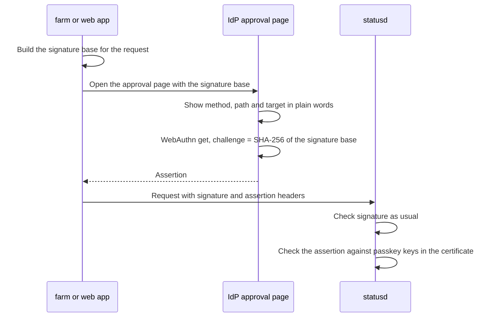

# Design

Agreed in pre-planning on 2026-10-28 and revised the same day. The planning page has the diagrams, prior art and trade-off matrix: <https://claude.ai/artifact/89imR2WNcuufa4Yc3gXDHr>. If the two disagree, this file is correct.

The goal is practice in applied cryptography on an established design (AWS request signing, SSH and X.509 client certificates, WebAuthn). It is not an experiment: wherever a standard exists, we use it.

## Priorities

1. FIDO2, YubiKeys and passkeys. No TOTP or separate second factor.
2. Reusable credentials: sign in once a day.
3. Little state and little configuration.
4. Testable, with coverage that's easy to read.
5. Auditable, with logs that are complete but not noisy.
6. Simple to use day to day.

## Threat model

| In scope | Answer |
|---|---|
| Attacker on the LAN reads or changes traffic | Signed requests can't be replayed outside the window or changed. Confidentiality comes from the transport (see [Transport](#transport-names-and-clocks)). |
| Credential copied from logs or a proxy | Nothing on the wire can be reused. Logs can hold full signature headers. |
| A breached service (such as statusd) | It holds only the CA public key. It can't create credentials or reuse the requests it receives elsewhere. |
| XSS in a web app | Cookies are HttpOnly and there are no tokens JS can read. XSS can still do ordinary writes while the page is open, an accepted risk. Destructive actions need a passkey touch. |
| Stolen laptop or key file | The attacker can do reads and ordinary writes until the certificate expires (at most 8 h). Destructive actions need the passkey. |
| Replay | A ±5 min window on `created`, a nonce cache on write routes, and services reject signatures created before they started. |

Out of scope:
- **Compromise of the IdP host.** The CA key lives there. Mitigations are hardening, a narrow sandbox, and CA rotation as the emergency stop.
- **Malware with a user's live session.** It can do everything the user can until expiry. The only exception is destructive actions, which still need a physical touch.

## Pieces

| Piece | Job | Where |
|---|---|---|
| Authenticator | WebAuthn sign-in with user verification required. | `cmd/sso`, own package |
| IdP and CA | SSO session, device flow, issues client certificates, destructive-action approval page. | `cmd/sso` |
| Auth proxy | Caddy `forward_auth` endpoint, HttpOnly SameSite=Strict cookie sessions. | `cmd/sso-proxy` |
| Shared library | Signs and verifies requests (`httpsig`), issues and verifies certificates (`cert`), verifies destructive-action assertions. Standard library only. | `lib/`, its own Go module |
| `farm` | Remote status and light management for microvms and slimdeploy previews, and the first real client of the SSO: `farm login` (device flow), `farm req` (signed requests). Not `mvm`, which stays the fast management tool on the host. | `github.com/oxgen1/farm` (~/Dev/farm) |

## Protocol profile

The fixed profile. Anything outside it is rejected, so there's nothing to negotiate.

- **Algorithm:** ES256 (`ecdsa-p256-sha256` in RFC 9421) everywhere: client keys, the CA, and passkeys.
  - Every FIDO2 authenticator supports it, and Go's standard library implements it.
  - One algorithm for everything removes a whole class of key-confusion bugs.
- **Request signatures:** RFC 9421, with a single label `sig1`.
  - Covered components, in this order and no others: `"@method" "@authority" "@path" "@query" "content-digest" "sso-cert"`. `content-digest` is SHA-256 (RFC 9530) and is present even for an empty body.
  - Required parameters: `created`, `expires` (at most `created` + 300), `nonce`, `keyid` (the certificate serial), and `tag="farm1-sso-v1"`.
  - The tag stops a signature made for this protocol being accepted by a different one.
- **Structured-field parsing:** only the RFC 8941 subset we emit. Anything else is rejected rather than interpreted.
- **Certificate:** X.509, parsed and verified with `crypto/x509` against a pool that holds only our CA. System roots are never used.
  - The certificate travels in the signed `sso-cert` header.
  - It carries:
    - the user as `Subject.CommonName`
    - the client public key
    - `NotBefore` and `NotAfter`
    - ExtKeyUsage `ClientAuth`
    - the services it's valid for, as URI SANs `https://id.auth.jack.farm/services/<name>`, and nothing else in the SAN
    - three private extensions, each left out when empty:
      - roles: `SEQUENCE OF PrintableString`, sorted, not critical
      - passkeys: `SEQUENCE OF SEQUENCE { credentialID OCTET STRING, publicKey SubjectPublicKeyInfo }`, the keys converted from COSE by the IdP, not critical
      - source addresses: `SEQUENCE OF OCTET STRING`, each address‖mask as in RFC 5280 name constraints. Critical, because a verifier that ignored it would accept the certificate from anywhere; ignoring the other two only grants less.
    - a 128-bit serial, which is the `keyid` as 32 hex digits
  - The extensions need a private OID arc. The planned `2.25.<uuid>` arc can't work: `crypto/x509` parses extension OIDs into `[]int` and rejects any arc of 2³¹ or more, so a certificate carrying one doesn't parse at all. The arc will be an IANA Private Enterprise Number (`1.3.6.1.4.1.<PEN>`, free to register); until then the code uses `2.999.7`, from the arc reserved for examples.
  - Only the profile `CA.Issue` produces is accepted: P-256 key, ECDSA-SHA256, a lone CN, `digitalSignature` and `clientAuth` only, not a CA, exactly the expected extensions, lifetime at most 8 h plus the 5-minute backdate. Each extension value is re-encoded and compared, so it has one accepted encoding. `Issue` runs the same check on its own output.
  - Checked in this order: CA signature (`CheckSignatureFrom`, not `x509.Verify`, as there's no path to build), profile, `keyid` equals the serial, validity period, service, source address. The signature comes first so `cert_expired` and `scope` are only reported for certificates the CA issued.
  - Using X.509 avoids inventing a token format, whose canonicalization would be exactly where things go wrong. It also lets `openssl x509 -text` show any certificate during an audit.
- **Lifetime:** 8 h, a working day. Revocation is expiry plus narrow scopes. CA rotation is the emergency stop.
- **Component values:**
  - `@authority` is the Host header lowercased, with the port kept as sent. RFC 9421 drops a default port, but none of our services use one, and keeping it means a verifier needn't know the scheme.
  - Each covered header must appear exactly once.
  - Values with control characters or non-ASCII bytes are rejected, so no value can forge another line of the signature base.
  - Signatures are `r‖s` (64 bytes), as RFC 9421 §3.3.4 requires, not ASN.1.
- **Signer:** `expires` is `created` + 60 s, and the nonce is 16 random bytes (base64url).
- **Verification order,** cheapest first:
  1. parse the headers and rebuild the signature base
  2. `created`/`expires` window (and, on write routes, created after the service started)
  3. tag
  4. `@authority` is one of this service's names, so a request can't be replayed against another service the same certificate covers
  5. certificate chain, expiry, service and source-address scope
  6. content digest
  7. signature
  8. nonce (write routes only). It comes after the signature so only a correctly signed request can take a slot in the cache. Otherwise anyone who saw a certificate on the wire could fill the cache and block writes.
  9. tier and role (in the service)

  Each failure returns one reason code from a closed set defined in the library: `malformed`, `profile`, `expired`, `not_yet_valid`, `before_start`, `tag`, `authority`, `cert`, `cert_expired`, `scope`, `digest`, `sig_mismatch`, `replay`, `nonce_full`.

## Tiers

| Tier | Examples | Proof |
|---|---|---|
| Read | status, lists | a valid signature with any certificate for this service |
| Write | restart, deploy | a valid signature, plus the `write` role in the certificate |
| Destructive / admin | credential and user management, terminating VMs | a valid signature, the `admin` role, and a passkey assertion over this exact request |

Each route declares its tier where it's registered. A route with no tier counts as destructive, and a test lists every route and fails if one has no tier.

### Destructive-action approval

The same flow works from the CLI and from a browser, and the CLI stays pure Go with no libfido2 or cgo:

The client sends it in one header, an RFC 8941 dictionary in the same canonical subset as the signature headers: `Sso-Assertion: id=:…:, ad=:…:, cd=:…:, sig=:…:` (credential ID, `authenticatorData`, `clientDataJSON`, DER signature; no user handle, since the certificate already names the user). The request signature doesn't cover this header and can't, as the assertion is made over the signature base. An assertion is only good for that one base, so nothing is lost.

statusd checks the assertion (`lib/assertion`), signature first so the later reasons are only reported for assertions the passkey really made:
- the credential ID is one of the passkeys in the certificate, and the signature verifies with its key
- `rpIdHash` is SHA-256 of the RP ID
- UP and UV are set; AT and ED are not, and `authenticatorData` is exactly 37 bytes (the page asks for no extensions)
- `clientDataJSON` starts with exactly `{"type":"webauthn.get","challenge":"<base64url of SHA-256 of the signature base statusd rebuilt>","origin":"https://id.auth.jack.farm"` followed by `}` or `,`. This is WebAuthn's limited verification algorithm (§5.8.1.2): browsers serialize these three first and in this order, so they're compared as bytes and no JSON parser decides what they are. The rest is parsed only to refuse `crossOrigin: true` and `topOrigin`.

Each failure has a reason from a second closed set, all prefixed `assertion_` so the audit log can't confuse them with signature reasons: `missing`, `malformed`, `credential`, `sig_mismatch`, `rp`, `flags`, `type`, `challenge`, `origin`.

The approval has no timestamp of its own; it lives as long as the request's signature (`created` + 60 s, plus the skew allowance), and the nonce cache stops it being used twice.

The signature counter is ignored. Synced passkeys report 0, and tracking the counter would mean storing state.

The approval page builds the summary it shows from the same signature base that it hashes, so you approve what you see.

## Sign-in and the SSO session

- The sign-in page asks for a WebAuthn get with `userVerification: "required"` and no `allowCredentials`: the browser offers the passkeys it holds for the RP ID, and the IdP finds the user from the credential ID. The assertion is checked by `lib/assertion` (`CheckChallenge`) with the same rules as approvals.
- A challenge is 32 random bytes, held in memory for 3 minutes (the browser gives up after 2) and good for one attempt: it's removed before the assertion is looked at, so a failed try needs a new challenge.
- The session is a random 128-bit token in a `__Host-sso` cookie: HttpOnly, Secure, SameSite=Strict, Path=/, no Domain. It lasts 8 h from sign-in and isn't extended by use. Signing in again replaces the browser's old session; signing out removes it from memory.
- Every POST must carry `Origin` equal to the IdP's origin. Pages send `Referrer-Policy: same-origin` (with `no-referrer`, browsers send `Origin: null` on form posts) and a CSP that allows only the IdP's own script and style.
- A redirect after sign-in (`next`) must be a path on the IdP itself.
- The client address, for rate limits and the audit log, is the peer's, except from loopback (Caddy on the same host), where it's the last `X-Forwarded-For` entry. Caddy replaces that header for clients it doesn't trust as proxies, so the last entry is the address it saw.
- The browser is told only that sign-in failed; the audit log has the reason (`lib/assertion`'s, or `login_challenge` for a challenge that's unknown, expired, used, or issued for a device approval).

## Device flow and certificates

`farm login` uses the OAuth device flow (RFC 8628), so the CLI never handles a passkey and stays pure Go.

1. `farm` makes a P-256 key pair and posts `client_id=farm` and a PKCS #10 CSR (`csr`, unpadded base64url DER) to `POST /device/code`.
   - The CSR's signature proves `farm` holds the key.
   - The subject must be empty and there must be no extensions: everything in the certificate comes from the configuration.
   - Only ES256 on P-256 is accepted.
2. The IdP answers as RFC 8628 §3.2 says: a device code, a user code, the verification URIs, `expires_in` 600 and `interval` 5.
   - The user code is 8 letters from RFC 8628's base-20 consonant alphabet (about 34.5 bits), shown as `XXXX-XXXX`.
   - The device code is the user code, a dot and 128 random bits. The user code finds the pending request; the random part, compared in constant time, proves the poller is the device.
   - At most 100 requests are pending. Each one costs a token from the same per-address bucket as starting a sign-in.
3. `GET /device` shows the pending request: the code, the address it came from, the key's SHA-256 fingerprint (as OpenSSH writes one; `farm` prints the same) and when it was asked. **Approving is a passkey assertion**, the same as sign-in (UV required, no `allowCredentials`, the user found from the credential ID), whose challenge is issued for that one request. The touch both says who the user is and approves; the SSO session plays no part, and approving doesn't start one.
   - So every certificate needs the authenticator at the moment it's issued. With approval through the session, a browser left signed in could mint certificates until the session ended, each lasting 8 h more: up to 16 h from one touch, against the threat model's 8.
   - A challenge records what it's for. A sign-in challenge can't approve a device, nor the reverse (`login_challenge` either way).
   - Denying is a plain form post and needs no passkey: anyone with the code can refuse, and refusing grants nothing. It can't undo an approval.
   - Looking up a code (the page, starting an approval, denying) has a token bucket per address (10, then one every 30 s), so nobody can search the code space.
   - If the user's certificates are limited to source addresses and the request came from outside them, approving denies it: the certificate would be useless there, and a request from somewhere the user can't be is more likely phishing than travel.
4. `farm` polls `POST /device/token` with the device grant. Errors are RFC 8628's: `authorization_pending`, `slow_down` (polling faster than the interval, which then grows by 5 s), `access_denied` and `expired_token`; a wrong secret is `invalid_grant`.
5. After approval, the next poll gets the certificate, issued then with the user's claims from the configuration, as `{"certificate": "<PEM>"}`. It isn't an OAuth access token, and it's the only non-standard part. The request is removed, so each code yields one certificate.

The audit log has `device_code` (with the user code and key fingerprint), `device_approve` (allow with the user and `passkey_cred_id`; deny with `user_denied`, `source`, `device_expired`, `device_handled`, or any reason a sign-in can fail with) and `certificate` (allow with `cert_serial`, the approving passkey and `not_after`, or deny with `device_code` for a wrong secret).

The CA key is read at start-up from `ca.key` in `$CREDENTIALS_DIRECTORY`, where systemd's `LoadCredential` puts it.

## Enrollment and recovery

- Users, roles and passkey public keys are declared in the Nix configuration. Public keys aren't secret, so the IdP has no user database.
- `sso enroll <user>`, run on the IdP host, prints a one-time enrollment link that lasts 10 minutes. Registering a passkey there prints the Nix snippet to paste into the configuration. The snippet is in the audit log too (`enroll`), so whoever deploys it can take it from there rather than from whoever registered.
- The link is `/enroll/USER.EXPIRES.NONCE.MAC`: an HMAC-SHA256 under a key derived from the CA key with HKDF (info `sso enroll link v1`). `sso enroll` and `sso serve` share nothing but the key they both already hold, and only someone who can read it can make a link. The MAC is checked before anything else in the link.
  - The link is used up by the first registration that succeeds; the server remembers used nonces until the links expire. A restart forgets them, so a link could be used again within its 10 minutes. That's accepted: a registration does nothing until someone pastes it into the configuration.
  - The token is kept out of the diagnostic log (the path is logged as `/enroll/…`).
- The page asks for a name first, checked before anyone touches a key (a valid name, not already used by that user). The browser is told to make a discoverable ES256 credential with UV required, and not to make a second one on an authenticator that already has one of the user's passkeys (`excludeCredentials`). The user handle is the first 16 bytes of a SHA-256 of the user name: stable, and nothing reads it back.
- A credential ID already enrolled for anyone is refused. A challenge records that it's for enrollment, so it can't sign in or approve, nor the reverse.
- Registration asks for attestation `none` and accepts only that: an ES256 key on P-256, UP and UV set, no extensions, and `clientDataJSON` checked with the same limited verification as approvals (type `webauthn.create`). With no attestation nothing is signed, so what ties the key to the enrollment is the challenge, which only the holder of the link has. The attestation object is the only CBOR in the system; `internal/webauthn` decodes it with `fxamacker/cbor` in a strict mode (no duplicate keys, indefinite lengths, tags or unknown fields).
- For recovery, enroll at least two authenticators (two YubiKeys, or a YubiKey plus a passkey). There is no TOTP or email fallback.

## Transport, names and clocks

- **RP ID:** `auth.jack.farm`. The IdP is served at `https://id.auth.jack.farm`.
  - The only other origin accepted is `http://localhost:PORT` with RP ID `localhost`, for trying the IdP on a laptop. Browsers treat localhost as a secure context, so WebAuthn and Secure cookies work there without TLS.
  - Every passkey is tied to the RP ID permanently. The host name can still change within `*.auth.jack.farm` without re-enrolling anyone.
  - `*.auth.jack.farm` is reserved for SSO code. Any origin under the RP ID can ask for a passkey assertion, so no other app is hosted there.
  - Services check `clientDataJSON.origin` against `https://id.auth.jack.farm` exactly, so an assertion made on any other page is rejected.
- **TLS:** served with a certificate that browsers trust, so `jack.farm` has to be a domain we control. A wildcard `*.auth.jack.farm` certificate through DNS-01 keeps individual host names out of Certificate Transparency logs.
- **What signatures don't cover:** they give authenticity and integrity, not confidentiality, and responses aren't signed.
  - Writes and logins reach the services over WireGuard only. statusd's write routes listen only on the WireGuard interface or the Unix socket.
  - Reads over the plain LAN are an accepted risk.
  - TLS on statusd may come later.
- **Clocks:** every client and service needs NTP. The `created` window is ±5 minutes.

## State

| State | Where | If it's lost (restart) |
|---|---|---|
| Users, roles, passkey public keys | Nix configuration | Declarative, so nothing is lost |
| CA private key | IdP, systemd `LoadCredential`, never in the Nix store | Rotate the CA, and everyone signs in again |
| CA public key | A Nix option on each service | Declarative |
| SSO sessions, pending challenges, device codes | IdP memory, with size limits and TTLs | Users sign in again |
| Proxy sessions | Proxy memory | Silent re-login through the SSO session |
| Nonce cache | Each service's memory, with a size limit | No replay risk, because services reject signatures created before they started. If the cache fills up, writes are rejected. |
| Rate-limit buckets | Memory | Reset |
| Client key and certificate | Client, 0600 file | Run `farm login` again |
| Audit log | journald, shipped off the host | Must not be lost |

## Logging

- **Audit log:** one JSON record per event, with a schema version.
  - Fields: `user`, `cert_serial`, `passkey_cred_id` (destructive tier only), `action`, `target`, `result`, `reason`, `request_id`, `client_ip`, `server_time`, `created`.
  - Events: logins, issued certificates, writes, destructive actions and denials. Reads are counted per user per minute.
  - A hash chain (`internal/audit`): each record is one JSON line with `seq` and `prev`, the hex SHA-256 of the line before it, as `sha256sum` prints it. An edited record breaks the next one's `prev`; a deleted one breaks `seq` as well.
    - Each run of the IdP is its own chain, from `audit_start` (`seq` 0, `prev` all zeros) to `audit_stop` on a clean shutdown. Nothing is kept on disk to link runs: that would be state for little gain, since the records are shipped off the host anyway.
    - `sso audit verify` checks `journalctl -o cat` output. Only the oldest chain may start without `audit_start`, as journald's retention removes the oldest records.
    - What a chain can't show: its newest records cut off, or a whole run deleted. The copy shipped off the host covers that. A chain with no `audit_stop` before the next `audit_start` is a crash or a cut, and worth a look.
    - Audit and diagnostic records share one writer with a lock, so lines never interleave.
  - Personal data (the IP) is kept for a fixed retention period.
- **Diagnostic log:** errors, panics with the request ID, and latency, one line per request.
  - On `sig_mismatch`, log a hash of the rebuilt signature base. `farm` prints the hash of the one it signed:
    - Different hashes mean the two sides wrote the request down differently (canonicalization).
    - Matching hashes mean the wrong key.
  - An opt-in debug flag logs the full signature base, so a failure can be reproduced offline with `farm verify`.
- Client IP is logged, never signed.

## Rate limits

- In-memory token buckets.
- Per IP on login and WebAuthn start (each one holds a challenge in memory).
- Device-flow polling uses `slow_down` (RFC 8628).
- Device-code lookups per IP. Each certificate already costs a passkey touch.
- Failed verifications per `keyid` and per IP.

## Testing

- **`lib`:**
  - The RFC 9421 Appendix B vectors that use `ecdsa-p256-sha256`.
  - Round-trip tests.
  - Mutation tests: changing any covered component, parameter or header must produce the expected reason code.
  - Fuzzing of the structured-field parser, the signature-base builder, certificate parsing, and the WebAuthn `authenticatorData` and `clientDataJSON` parsers.
  - A fixed clock in tests.
- **Reason-code coverage:** a test fails if any reason code has no test that produces it. Coverage of `lib` is checked in CI.
- **Interop:** the NixOS VM test checks that an independent RFC 9421 implementation verifies our signatures. This catches canonicalization drift.
- **End to end:** a NixOS VM test with a software WebAuthn authenticator covers enrollment, login, the device flow, read, write, destructive approval, expiry, replay, and the wrong service.

## Repository and consumption

- `github.com/oxgen1/sso`: IdP, authenticator, proxy, and the Nix module.
- `github.com/oxgen1/sso/lib`: a nested module holding `httpsig` and `cert`, standard library only (enforced by depguard). It's tagged `lib/vX.Y.Z` and only gets a new version when the protocol changes, so statusd's `vendorHash` only changes then.
- The repo is **public**, so statusd requires `github.com/oxgen1/sso/lib` like any other module. Making it reusable by other people is out of scope for now.

## Decided 2026-10-28

- **RP ID** is `auth.jack.farm`, with the IdP at `id.auth.jack.farm`.
- **The repo is public.**
- **Certificates last 8 h.**
- **Remote writes go over WireGuard only.** TLS on statusd comes later, if at all.
- **`jack.farm` is ours.** `0-0.biz` (also ours) might join later; that's out of scope.
  - Passkeys stay on `auth.jack.farm`, because apps on another domain redirect to `id.auth.jack.farm` to sign in, like any other app.
  - Such apps would need their own proxy cookie domain.
  - WebAuthn Related Origin Requests (`/.well-known/webauthn`) would cover using a passkey directly on another domain. Browser support varies.
